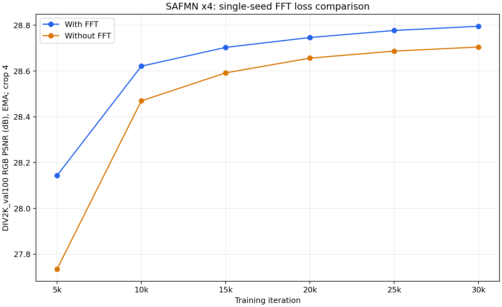

# SR Training Workbench

**Image super-resolution experiments built around data preparation, cloud training, and checkpoint analysis.**

This repository contains the experiment tooling and measurements I developed while studying ×4 single-image super-resolution. I built the dataset checks, resumable download and crop workflow, staged training setup, stop guard, and metric comparisons. The SAFMN and CAMixerSR network implementations belong to their original authors; their source code and pretrained models are linked below, not copied here.

## What I built

- Resumable, range-based downloads of the DIV2K and Flickr2K archives, with size checks and SHA-256 records.
- HR/LR pair validation, ×4 dimension checks, a combined DF2K index, resumable subimage preparation, and a checked BasicSR metadata index.
- Cloud training setups with saved checkpoints every 5,000 steps for SAFMN and every 1,000 steps for CAMixerSR, plus a SAFMN stop guard that checks both the checkpoint and validation score before stopping.
- Evaluation records that keep dataset, color channel, crop border, and checkpoint key (`params` versus `params_ema`) explicit.
- A sequential FFT/no-FFT experiment manager with shared initialization, checkpoint verification, paired evaluation, and result plots.
- Local CPU exercises for a parameter update and real-image inference, with curated visual examples.

## Latest controlled experiment: FFT loss at 30k

Two fresh SAFMN ×4 runs used the same RTX 5090, environment, DF2K crops, batch 64, seed 10, and shared random initial weights. The only training difference was **L1 + 0.05 FFTLoss versus L1 alone**. Each run completed 30,000 updates, retaining the original 500k cosine schedule and EMA 0.999.

| Loss | DIV2K val100 RGB PSNR | Set5 RGB PSNR | Set5 Y PSNR / SSIM |
| --- | ---: | ---: | ---: |
| L1 + 0.05 FFTLoss | **28.7956 dB** | **30.0542 dB** | **31.9488 dB / 0.891679** |
| L1 | 28.7050 dB | 29.9539 dB | 31.8489 dB / 0.889826 |

All values use `params_ema` and border crop 4. Set5 values are five-image means. The DIV2K advantage narrowed from **+0.4089 dB at 5k to +0.0906 dB at 30k**. This supports an FFT benefit in this single-seed short run; it does not establish convergence, multi-seed stability, or full-paper results.



See the [complete experiment record](docs/SAFMN-FFT-paired-30k.md), [validation CSV](results/safmn_fft_pair_30k/results/training_metrics.csv), and [visual comparisons](results/safmn_fft_pair_30k/results/comparisons). All 12 checkpoint/state pairs passed readability, finite-value, iteration, and hash checks; the records are included, while binary weights remain outside Git.

## Earlier training and pipeline checks

| Item | Setting |
| --- | --- |
| Task | Bicubic ×4 single-image super-resolution |
| Training data | DF2K: 800 DIV2K + 2,650 Flickr2K HR/LR pairs |
| Prepared data | 139,995 aligned HR/LR crop pairs |
| Validation | DIV2K validation set, 100 images; RGB PSNR, border crop 4 |
| Additional check | Set5 mirror, 5 images; Y-channel PSNR/SSIM, border crop 4 |
| Main training run | SAFMN, batch 64, 256-pixel HR random crops, L1 + 0.05 FFT loss |
| Earlier loss ablation | Same 5k setup and seed, with FFT loss disabled (`fft_opt: ~`); distinct from the new 5090 paired experiment above |
| SAFMN hardware/environment | One RTX 4090 24 GB; Python 3.10; PyTorch 2.1.1+cu121 |
| CAMixerSR short training | 5,000 steps from scratch; batch 16; 256-pixel HR random crops; L1 + routing constraint; seed 10; EMA 0.999 |
| CAMixerSR optimization | AdamW; learning rate 0.0005; weight decay 0.0001; betas (0.9, 0.99) |
| CAMixerSR hardware/environment | One RTX 5090 32 GB; project-local environment; PyTorch 2.7.1+cu128; BasicSR 1.4.2 |

### Earlier measured results

| Model/checkpoint | Weights used | DIV2K val100 RGB PSNR | Set5 Y PSNR / SSIM |
| --- | --- | ---: | ---: |
| SAFMN author's pretrained ×4 | `params` | 28.9615 dB | 32.1836 dB / 0.8948 |
| SAFMN trained from scratch, 5k | `params_ema` on DIV2K; `params` on Set5 | 28.1530 dB | 31.4363 dB / 0.8828 |
| SAFMN trained from scratch, 5k without FFT loss | `params_ema` | 27.7030 dB | — |
| SAFMN trained from scratch, 20k | `params_ema` | 28.7439 dB | — |
| SAFMN trained from scratch, 30k | `params_ema` | 28.7915 dB | — |
| SAFMN trained from scratch, 30k | `params` | 28.6901 dB | 31.7874 dB / 0.8895 |
| CAMixerSR author's pretrained ×4 | `params_ema` | — | 32.5533 dB / 0.8997 |
| CAMixerSR trained from scratch, 5k | `params_ema` | 27.5543 dB | — |

The CAMixerSR run completed 5k without reported errors. EMA validation at 1k/2k/3k/4k/5k returned **17.3931 / 22.1289 / 25.4935 / 26.8954 / 27.5543 dB**. The saved 5k model and training state loaded successfully; the state records iteration 5000, the model contains finite `params` and `params_ema`, the training process exited, and the GPU compute-process list is empty.

The training entry point calls validation once more after the loop; that additional validation returned 27.5540 dB without further training. Both values are retained separately, with 27.5543 dB as the 5k checkpoint validation result. The 0.0003 dB difference has not been strictly attributed to a cause. See the [CAMixerSR run record](docs/CAMixerSR-short-training-plan.md). This is a single 5k short training run. Its batch size and optimization settings differ from the SAFMN runs, so the results do not support a fair ranking of the two architectures.

The SAFMN run stopped at 30k because its EMA validation PSNR improved by only 0.0476 dB from 20k to 30k and met the preselected short-run stopping rule. The ordinary 30k weights remain 0.2714 dB below the author's pretrained weights on the same DIV2K protocol. **This is a controlled short training experiment, not a claim to have completed the authors' 500k-step training or matched their paper results.** The 500k learning-rate schedule was retained, so the 30k result should not be interpreted as a fully converged short-schedule model.

An [independent direct test](results/logs/SAFMN_DIV2K_val100_30000_ema.stdout.log) that explicitly loaded `params_ema` reproduced the 30k training validation score of 28.7915 dB on the same 100-image protocol.

In the single 5k loss ablation, disabling the 0.05-weight FFT loss gave **0.4500 dB lower** DIV2K val100 RGB PSNR than the otherwise matched 5k run. See the [no-FFT training log](results/logs/nofft5000.stdout.log) and [experiment notes](docs/experiment-notes.md). This one short run does not establish the effect after full 500k-step training.

The Set5 files came from a third-party mirror and include only five test images. Set5 Y-channel scores and DIV2K RGB scores are different protocols; compare values only within their own column. See [all recorded metrics](results/metrics.csv) and the [experiment notes](docs/experiment-notes.md).

## Repository layout

```text
configs/          Training and evaluation YAMLs used in the cloud experiment
scripts/          Data preparation, environment setup, preflight, training manager, evaluation
learning/         Local CPU exercises and curated inference examples
results/metrics.csv
results/logs/     Selected raw logs supporting the table above
results/safmn_fft_pair_30k/  Paired-run evidence, metrics, curves, predictions
docs/             Data provenance, run steps, and interpretation notes
```

The YAML files intentionally preserve the absolute paths used in my cloud run (`/root/fsas/sr-repro`). Change the `dataroot_*`, `meta_info_file`, and checkpoint paths for a new machine. The stop guard also records the original process ID and paths; treat it as an experiment artifact and adapt it before another run.

## Data and code provenance

- [SAFMN](https://github.com/sunny2109/SAFMN) at `1a412066e927da640bc7e2a53ea60f9ffc134241` supplied the model and BasicSR-based training pipeline.
- [CAMixerSR](https://github.com/icandle/CAMixerSR) at `d690b12bb2a0a185dc0049538b377d569f520497` supplied the second network, its BasicSR-based CAModel training extension, and pretrained weights. The local compatibility changes and 5k training setup are documented in the [CAMixerSR run record](docs/CAMixerSR-short-training-plan.md).
- [BasicSR](https://github.com/XPixelGroup/BasicSR) at `8d56e3a045f9fb3e1d8872f92ee4a4f07f886b0a` was studied separately; SAFMN contains its own BasicSR-based code.
- [DIV2K](https://data.vision.ee.ethz.ch/cvl/DIV2K/) and [Flickr2K](https://cv.snu.ac.kr/research/EDSR/) supplied the training images. The DIV2K page describes academic research use and requests citation. Dataset images and archives are not included here.
- The Set5 evaluation used a [third-party dataset mirror](https://huggingface.co/datasets/eugenesiow/Set5), so these scores are recorded as local protocol checks rather than official benchmark claims.

Training datasets, upstream source trees, environments, and model weights are not committed. Selected Set5 predictions and comparison figures are included as experimental illustrations, with their origin recorded in [third-party attribution](THIRD_PARTY.md). The earlier 30k model and optimizer state remain outside this public repository; their hashes and validation evidence are documented in [experiment notes](docs/experiment-notes.md).

For hands-on study, start with the [local learning guide](learning/README.md) and its [curated CPU inference examples](learning/examples/README.md). Cloud setup and manager scripts preserve the original directory layout and prerequisites; they are run records and adaptable tools, not a one-command clean-machine installer.

See [third-party attribution](THIRD_PARTY.md) for the origin of model code, configuration formats, and data.

## Running the data pipeline

The following commands show the order of the scripts. Clone SAFMN into `./SAFMN` at the pinned commit and create a project-local Python environment with the upstream dependencies first. Plan for substantial cloud storage; the recorded 100 GB data disk held the source images and prepared crops.

```bash
python scripts/data/download_training_data.py datasets/_archives
python scripts/data/extract_training_data.py datasets
python scripts/data/prepare_df2k_pairs.py datasets
python scripts/data/prepare_safmn_subimages.py datasets
python scripts/data/build_meta_info.py datasets/DF2K --expected-count 139995
```

The last two scripts create aligned crops and `datasets/DF2K/meta_info_HR_sub.txt`, checking that names and dimensions match. This metadata-index command packages the manual check used in the original cloud run into a reusable step. Set the paths in `configs/safmn/train/SAFMN_train_DF2K_x4_sub_first5000.yml`, run it from the SAFMN checkout, and use `configs/safmn/train/SAFMN_train_DF2K_x4_sub_cloud.yml` with BasicSR's `--auto_resume` to continue. See the [experiment notes](docs/experiment-notes.md) for the exact stages and caveats.
