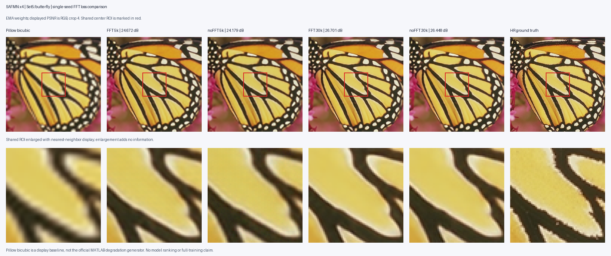

# SAFMN：同环境 FFT／无 FFT 各 30000 步对照

状态：**已完成并通过验收**。北京时间 2026-10-23 22:36:26 启动，2026-10-24 05:15:31 完成两组训练、检查点核验及评估，总计约 6 小时 39 分钟。
两组实际训练进度均到 30000 步；各六份模型与训练状态可读、数值有限且哈希匹配。管理器、训练及评估进程均已退出，GPU 计算进程已释放。
重要记录与完整评估图片已保存到本地，监控已暂停。**尚未核实云平台实例关机；需在平台关闭实例以停止计费。**

## 主要结果

DIV2K_val100，`params_ema`，RGB PSNR，裁边 4；数值越高越好。

| 更新步数 | L1 + 0.05 FFTLoss / dB | 仅 L1 / dB | 含 FFT − 无 FFT / dB |
| --- | ---: | ---: | ---: |
| 5000 | 28.1437 | 27.7348 | +0.4089 |
| 10000 | 28.6212 | 28.4697 | +0.1515 |
| 15000 | 28.7032 | 28.5920 | +0.1112 |
| 20000 | 28.7464 | 28.6564 | +0.0900 |
| 25000 | 28.7772 | 28.6871 | +0.0901 |
| 30000 | **28.7956** | **28.7050** | **+0.0906** |

本次单种子实验中，FFT 组在六个检查点均有更高的验证 PSNR，早期优势随训练缩小，20k–30k 的差距约为 0.09 dB。
两组最后 5000 步仍分别提高 0.0184、0.0179 dB，不能据此宣称充分收敛；也不能推出完整 500k 训练或其他种子具有相同收益。
原日志中的训练结束附加验证两组分别仍为 28.7956、28.7050 dB（日志迭代标签为 30002），单独保留在原日志中，不计入上述六个定期检查点。

### Set5 独立评估

每种设置均评估五张完整图，表中为逐图指标的算术均值；使用 `params_ema`、BasicSR PSNR/SSIM、uint8 图像、裁边 4。

| 损失 | 步数 | RGB PSNR / dB | RGB SSIM | Y PSNR / dB | Y SSIM |
| --- | ---: | ---: | ---: | ---: | ---: |
| L1 + FFT | 5000 | 29.1449 | 0.843548 | 31.0367 | 0.877296 |
| 仅 L1 | 5000 | 28.6661 | 0.837597 | 30.5768 | 0.873219 |
| L1 + FFT | 30000 | 30.0542 | 0.861089 | 31.9488 | 0.891679 |
| 仅 L1 | 30000 | 29.9539 | 0.858824 | 31.8489 | 0.889826 |

30k 时 Set5 均值差为 RGB PSNR +0.1003 dB、Y PSNR +0.0999 dB。图中 Pillow bicubic 仅为可视化参考，不是官方 MATLAB 退化生成器；同一中心区域的放大不增加新信息。

## 目的与范围

用户希望现在由云端先产出耗时的实验材料，之后直接结合结果学习，并明确允许放宽运行时间。
本轮有限目标为两组各 30000 次更新，检验早期 FFT 损失的收益在较长训练中是否保留。
两组在当前同一张 RTX 5090、同一个 SAFMN 项目环境中顺序运行，从同一份种子 10 的随机初始权重开始。
旧 4090 实验及其检查点保持原样，作为历史记录；本轮主比较使用新两组实验。

这是单种子、保留作者长周期学习率安排的 30k 对照，不代表完整 500k 训练、充分收敛或多种子结论。

## 固定条件

| 项目 | 设置 |
| --- | --- |
| 网络 | SAFMN ×4，dim 36，8 个特征块，ffn_scale 2.0 |
| 初始参数 | 公共 `common_init.pth`，固定种子 10 生成的随机权重；同时包含相同初值的 params、params_ema |
| 训练管理 | SAFMN 仓库内的 SRModel（含 FFT 损失支持） |
| 数据 | 原有 139,995 对 DF2K HR/LR 图块，HR 随机裁剪 256，LR 64 |
| Batch / workers | 64 / 8，单 GPU；预检为避免无关进程使用 0 workers |
| 优化器 | Adam，初始 lr 0.001，betas 0.9/0.99，weight decay 0 |
| 学习率 | 原 500000 步余弦周期，eta_min 0.00001；本轮仅覆盖前 30000 步 |
| EMA | 0.999 |
| 唯一训练差异 | L1 + 0.05 FFTLoss，或仅 L1 |
| 验证 | DIV2K_val100，EMA，RGB PSNR，裁边 4 |
| 保存与验证频率 | 每 5000 步，至每组 30000 步 |

两份 YAML 的结构化内容除实验名称、FFT 损失选项外必须相同。`pretrain_network_g` 字段指向公共随机初始化文件，并不表示使用训练过的模型；两组均不恢复旧 optimizer/state。

## 环境与预检

环境为 `/root/fsas/sr-repro/SAFMN/.venv-5090`。通过离线复制已验证的 CAMixerSR 环境包建立独立目录，原环境不变，也不修改系统 Python。
依赖版本与 CUDA 能力由 `environment.txt`、`setup.json` 和 `preflight.json` 实测记录。
SAFMN 源码的 torchvision 旧灰度函数导入需兼容当前接口，修改前源文件保存到 suite 的 `originals/`。

预检对两组分别完成三次真实 batch 64 的诊断更新，确认：

- 原始网络与 EMA 初值严格等于公共初始化；
- 输入 `[64,3,64,64]`、目标及输出 `[64,3,256,256]`；
- 损失有限、参数确实变化、EMA 推理输出有限；
- 记录峰值显存及每步纯计算耗时。

诊断参数丢弃，正式训练重新加载公共随机初值。

### 启动前实测

- PyTorch 2.7.1+cu128、torchvision 0.22.1+cu128，Pillow 10.4.0；实际导入 SAFMN 仓库内 BasicSR，源码版本 1.3.4.8。环境中的安装版 BasicSR 元数据为 1.4.2，正式训练使用 checkout 代码。
- 两组均严格匹配公共初值，初始参数量 239,520，诊断损失全部有限，参数确实更新，EMA 输出尺寸正确。
- FFT 组峰值已分配显存 5.34 GiB，无 FFT 组 4.63 GiB；预热后诊断纯计算约 0.06–0.07 秒/步。正式训练还包含数据读取和验证，不据此直接推算完整耗时。
- 公共初始化 SHA-256：`d31f76fa74adf41aaa8bde7c3c2c5e8affb5435df346310fe7161852872969d2`。
- FFT 配置 SHA-256：`da5e7eaaea5bf19ab94b981c0c7dea74c6db58ed43d4d6b6b9f54230c44dd6a3`。
- 无 FFT 配置 SHA-256：`7788de807cc29a128a39cf895f0bee7cd09e288b11f98ef0856f2cf792f6a4d7`。
- 预检、依赖、启动和源码记录已归档到 `results/safmn_fft_pair_30k/`；兼容补丁为 `patches/SAFMN_torchvision_grayscale.patch`。

## 云端路径及自动执行

Suite：`/root/fsas/sr-repro/safmn_fft_pair_30k`。

- `configs/train_fft_30000.yml`、`configs/train_nofft_30000.yml`
- `fft.stdout.log`、`nofft.stdout.log`
- `runner.pid`、`fft.pid`、`nofft.pid`
- `status.json`、`runner.log`
- `fft.checkpoint_verification.json`、`nofft.checkpoint_verification.json`

实验分别保存到 SAFMN 的 `experiments/SAFMN_DF2K_x4_pair_fft_30000` 与 `experiments/SAFMN_DF2K_x4_pair_nofft_30000`。

`run_safmn_fft_pair.py` 顺序启动两组，拒绝覆盖已有正式实验；读取实际 epoch 进度并检测非有限损失及报错。
任何一组失败即停止队列，不自动重试或更改配置。两组训练结束后，验证全部 5k 间隔 checkpoint/state 可读、迭代正确、数值有限，并记录哈希。
训练循环结束后的附加验证保留在原日志中，不替代定期检查点验证分数。

## 已交付结果与验收

`evaluate_safmn_fft_pair.py` 在两组成功后自动生成并验收：

1. 各 5k 间隔的 DIV2K 验证 CSV 和两条学习曲线。
2. 两组 5k、30k EMA 权重的 Set5 五图 RGB/Y PSNR、SSIM，逐图和均值记录。
3. 20 张预测图片，以及五张包含插值、两组 5k/30k 和 HR 的同区域对比图。
4. 输入、配置、环境、初始化、检查点、输出的来源和哈希记录。

本地归档目录为 `results/safmn_fft_pair_30k/`，其中 `results/` 保存全部评估产物：

- `status.json`：两组及评估完成；`fft.checkpoint_verification.json`、`nofft.checkpoint_verification.json`：各六份检查点验收通过。
- `final_verification.json`：再次实测读取全部 12 份模型和对应 state，核对 state 迭代、params/params_ema、有限数值、哈希、进程退出及 GPU 释放。
- `results/evaluation.json`：`completed: true`，30 个评估产物哈希在云端及本地复核一致。
- `results/training_metrics.csv`：12 条定期验证；`set5_per_image.csv`：20 条；`set5_mean.csv`：4 条；`set5_metrics.json`：完整逐图指标。
- `results/predictions/`：20 张预测；`results/comparisons/`：5 张对比；`results/training_curve.png`：验证曲线。
- 两份训练配置、训练/管理/评估日志、环境、预检、启动、源码版本及脚本均已归档。

本轮保存 58 个云端文件到本地，保留启动时的历史记录。未下载数据集、环境或二进制权重，未自动提交 Git。云端模型和训练状态仍保留在共享盘实验目录。
GitHub 整理时保留了实际运行的 manager/evaluator 脚本快照，便于匹配原始来源哈希；`scripts/` 中的后续版本补齐了自定义 root/suite 路径透传。原始日志、指标和图片未改写。
后台队列可独立于 SSH 和本地电脑继续执行。训练结束停止计算进程；停止实例计费需要平台关机，不能以 SSH 退出或训练结束代替平台关机状态。

本聊天的对照实验监控现已暂停。当前没有已设置平台定时关机或实例已关闭的证据；请在云平台关闭实例停止计费。
