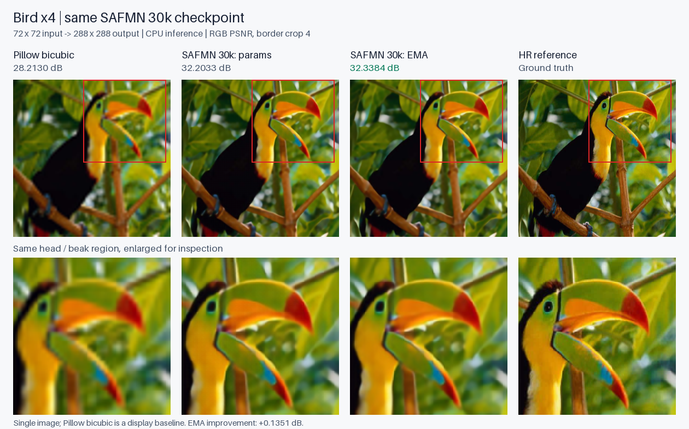
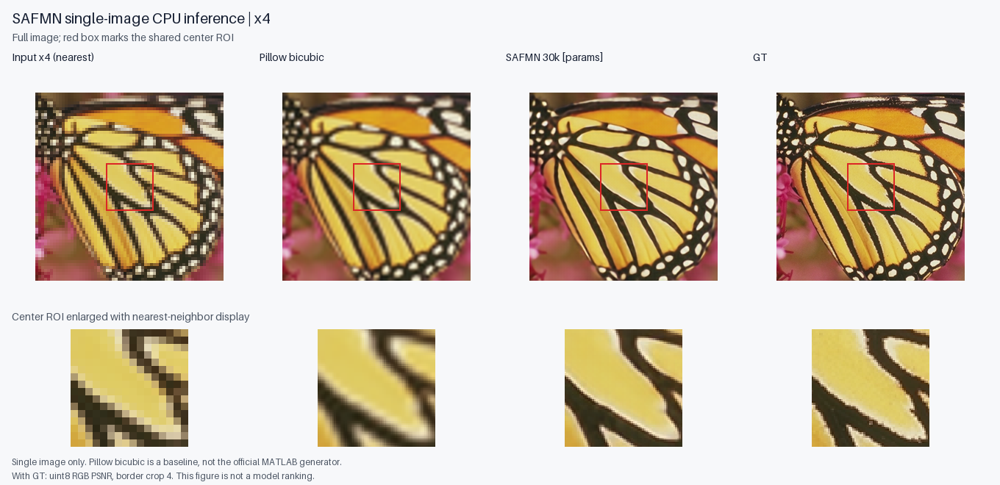

# 本地 CPU 推理：精选实测样例

这些图片可直接查看，不需要开启云服务器。原始推理输出保留在本机 `learning/outputs/`，这里只收录两张对比图和对应测量记录。

使用的是早期 **4090 SAFMN 30k** 检查点，不是后续 5090 FFT 配对实验的模型。检查点 SHA-256 为 `c8f372864a1479fb555d1f2a4793b31ce5d1e6a55741ca2393b37606dc0370f3`。
所有 PSNR 都是单图、uint8 RGB、裁边 4；Pillow bicubic 是本地直观参照，不是官方 MATLAB 数据生成器。

## 同一检查点：普通参数与 EMA

| Bird ×4 | RGB PSNR / dB |
| --- | ---: |
| Pillow bicubic | 28.2130 |
| `params` | 32.2033 |
| `params_ema` | 32.3384 |

同一低清输入由 72×72 放大为 288×288。本图中 EMA 比普通参数高 0.1351 dB；这是一张图上的结果，不能推出 EMA 在所有图像上都更好。

[完整测量记录](bird_params_vs_ema/result.json) 保留原始单次前向耗时、模型/权重哈希与原记录哈希。单次 CPU 耗时未预热，不能用作网络效率排名。

## 普通参数：蝴蝶图像

64×64 → 256×256；SAFMN 为 **26.4593 dB**，Pillow bicubic 为 **20.8645 dB**。

[测量记录](butterfly_30k/result.json)。图片源于 [Set5 镜像](https://huggingface.co/datasets/eugenesiow/Set5)，高清参照面板归原始图像来源，见 [第三方来源说明](../../THIRD_PARTY.md)。

公开 JSON 仅将原机器绝对路径规范为 `${WORKSPACE_ROOT}` / `${REPOSITORY_ROOT}`，测量值未改变。外部数据、权重及本机原始输出路径用于说明来源，不表示这些文件随仓库提供。
